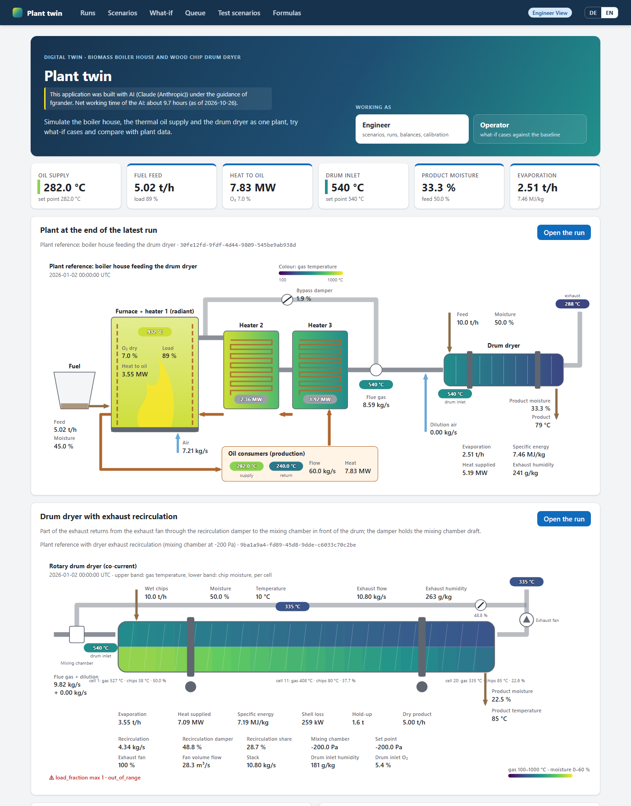
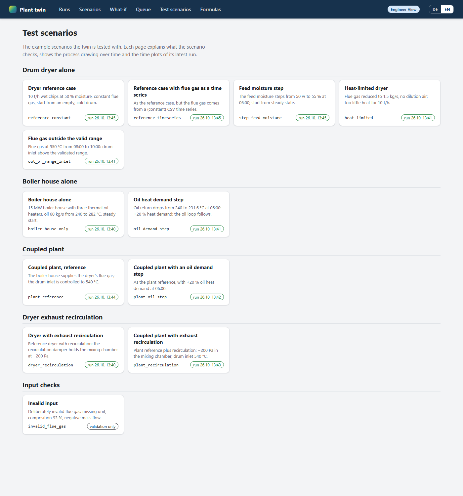
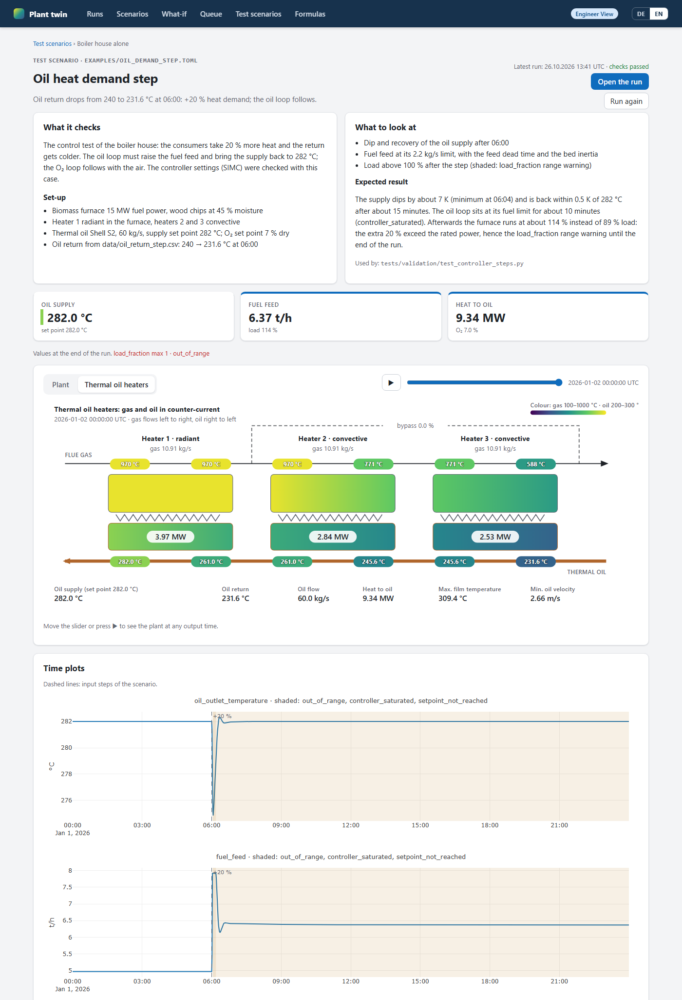
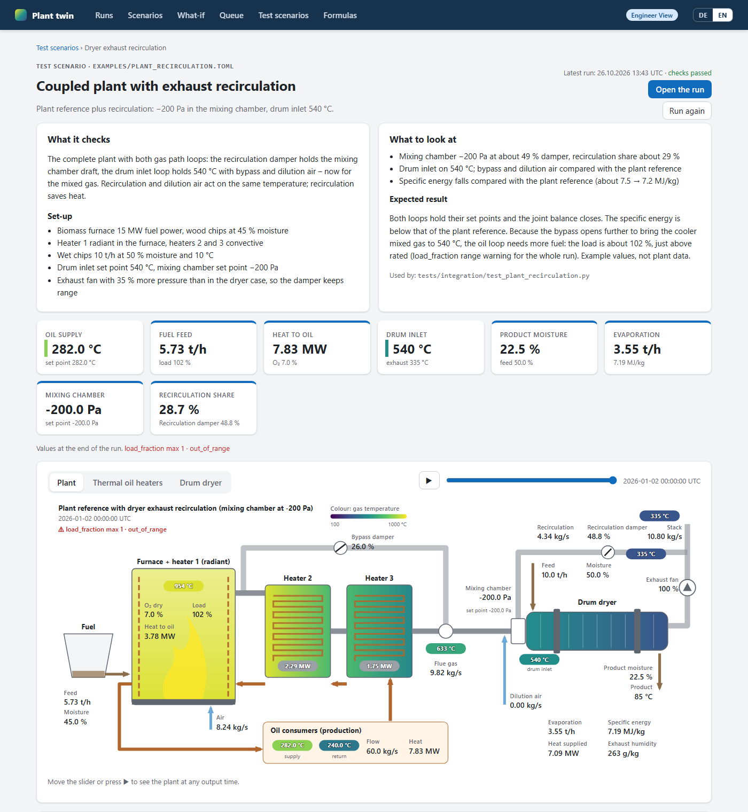

# boi-dry-dig-twi

Digital twin of a boiler house and the wood chip rotary drum dryer it feeds:

- a validated, unit-aware **flue gas supply interface** between a boiler house and a dryer,
  fed by constant values, a time series or the boiler house model (feature 001);
- a **dynamic model of a directly heated, co-current rotary drum dryer** for wood chips,
  with mass and energy balance checks, range warnings and reproducible run records
  (feature 001);
- a **dynamic boiler house model** (feature 002): biomass furnace, radiant and convective
  thermal oil heaters supplying oil at 282 °C, a gas bypass, and PI loops for the oil
  temperature (fuel feed), O₂ (combustion air) and the drum inlet temperature (split range
  bypass / dilution air). It runs alone or coupled with the dryer as one plant;
- a **comparison** of dryer and boiler house results with measured time series;
- a **local web app** (feature 003) to browse and plot runs, edit and start scenarios
  (including step changes), let operators run what-if cases against a baseline, and compare
  runs with plant measurements: `uv run boidrytwin serve`, or `BoiDryTwin.exe` (one Windows
  program that opens the browser by itself; build with `scripts\build_exe.ps1`), see
  [docs/webapp.md](docs/webapp.md).

> The models are not yet calibrated or validated against plant data; see
> [docs/model.md](docs/model.md#drum-dryer-model) and
> [docs/boiler_house.md](docs/boiler_house.md).

## Screenshots

Home page: the plant at the end of the latest run and the drum dryer with exhaust
recirculation.



One page per test scenario (`examples/*.toml`), with explanation, process drawing over time
and time plots; the dashed line marks the input step.

| Test scenarios | Oil heat demand step |
| --- | --- |
|  |  |

The formulas page is shown as a whole: every formula of the models with its symbols, the code
that computes it and its sources.

<table>
<tr><th>Coupled plant with exhaust recirculation</th><th>Formulas of the models</th></tr>
<tr>
<td valign="top"></td>
<td valign="top"></td>
</tr>
</table>

## Installation

Requires Python 3.12+ and [uv](https://docs.astral.sh/uv/).

```powershell
uv sync --all-groups              # add --extra web for the web app
```

## Quickstart

```powershell
uv run boidrytwin validate examples/reference_constant.toml
uv run boidrytwin run examples/reference_constant.toml --profiles
uv run boidrytwin rerun runs/<run_id>/run_record.json
uv run boidrytwin compare examples/reference_timeseries.toml examples/synthetic_measured.csv

uv run boidrytwin run examples/boiler_house_only.toml     # boiler house alone
uv run boidrytwin run examples/plant_reference.toml       # boiler house feeding the dryer
uv run boidrytwin compare examples/oil_demand_step.toml examples/synthetic_boiler_measured.csv

uv run boidrytwin serve                                   # web app on http://127.0.0.1:8765
```

Each run writes `runs/<run_id>/` with `run_record.json`, `results.csv` (second row: units),
optional `profiles.csv` and `final_state.json`. Runs with a boiler house add
`boiler_results.csv`, controller settings and a plant balance report (boiler house, oil
circuit and, coupled, dryer, interface and whole plant); coupled runs also write the
interface time series `flue_gas_to_dryer.csv` and `dilution_air.csv`, which can drive a
dryer-only run. Exit codes: 0 success, 1 input rejected,
2 checks failed (balances or validation tolerances), 3 solver failure. Logs are JSON lines
on stderr (`--log-format console` for humans).

Scenarios are TOML files where every physical value carries its unit, e.g.
`temperature = "650 degC"`; see
[contracts/scenario-file.md](specs/001-boiler-dryer-interface/contracts/scenario-file.md),
[contracts/scenario-file-boiler.md](specs/002-boiler-house-model/contracts/scenario-file-boiler.md)
and the [examples](examples/README.md). The end-to-end check lists are the quickstarts of
[feature 001](specs/001-boiler-dryer-interface/quickstart.md) and
[feature 002](specs/002-boiler-house-model/quickstart.md).

From Python:

```python
from boidrytwin import load_scenario, run

record = run(load_scenario("examples/reference_constant.toml"), out_dir="runs")
```

## Development

```powershell
uv run ruff check .; uv run ruff format --check .; uv run mypy
uv run pytest                 # unit, contract, integration and validation tests
uv run pytest -m benchmark    # performance (SC-007)
```

Work follows spec-driven development with GitHub Spec Kit: the project
[constitution](.specify/memory/constitution.md) and, per feature, spec, plan, research and
tasks under [specs/001-boiler-dryer-interface](specs/001-boiler-dryer-interface/),
[specs/002-boiler-house-model](specs/002-boiler-house-model/) and
[specs/003-web-frontend](specs/003-web-frontend/). Tests are written before the
code. `scripts/tune_controllers.py` retunes the oil and O₂ loops from step tests on the
twin.

## Layout

```text
src/boidrytwin/
  interface/    flue gas supply interface (no dependency on the dryer)
  properties/   flue gas, water, wood, solid fuel and thermal oil properties
  dryer/        configuration, transport, heat transfer, drying, model, simulator
  boiler_house/ fuel bed, furnace, heaters, bypass, model (no dependency on the dryer)
  control/      PI controller with anti-windup, split range
  plant/        coupling of boiler house and dryer, plant simulator
  webapp/       local web app (optional extra "web"): pages, API, queue, worker
  scenario/     scenario and time series loading and validation
  checks/       balances and range warnings
  validation/   comparison with measurements
  records.py    run folders, rerun, compare
  cli.py        command-line interface
tests/          unit, contract, integration, validation, performance
examples/       example scenarios and data
docs/model.md   dryer model equations, assumptions, calibration parameters
docs/boiler_house.md  boiler house model, control loops, VERIFY list
docs/webapp.md  the web app: start, views, pages, files it writes
docs/recirculation.md  exhaust recirculation and mixing chamber draft (feature 004)
```

## License

[MIT](LICENSE)
