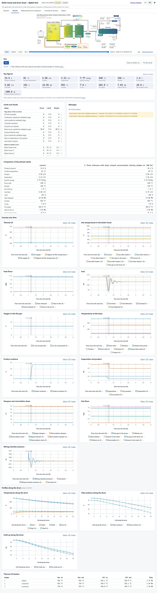
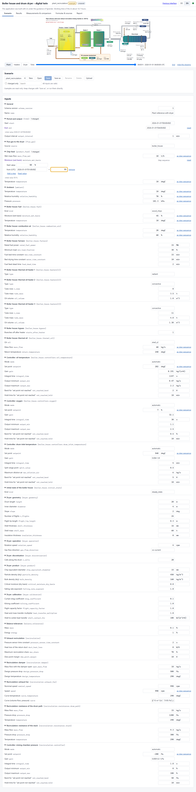
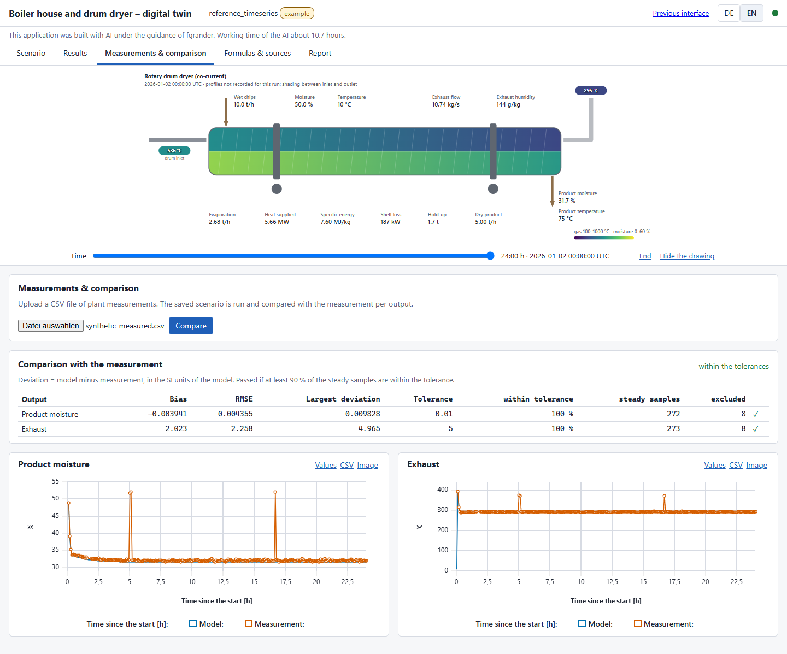
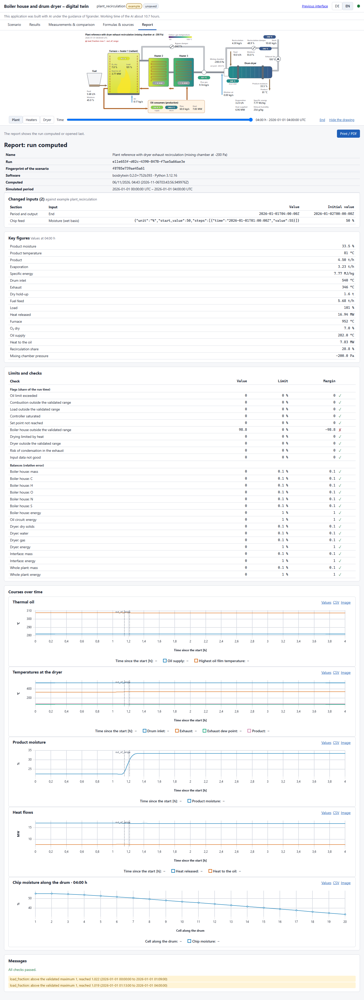

# Web app

A local web app for the plant twin (feature 003, [spec](../specs/003-web-frontend/spec.md);
the single page of feature 005, [spec](../specs/005-single-page-ui/spec.md)). On one page it
edits a scenario, runs it, shows the results against pinned runs, compares a run with plant
measurements, lists the formulas and prints a report. It never changes the models: every run is
made by the same functions as `boidrytwin run` and `boidrytwin compare`, and reruns from the
command line give identical results. The page computes nothing itself; it shows what the local
service computes.



## Start

```powershell
uv sync --extra web
uv run boidrytwin serve                     # http://127.0.0.1:8765, opens the browser
uv run boidrytwin serve --runs D:\twin\runs --scenarios D:\twin\scenarios --port 8800 --no-browser
```

`Ctrl+C` stops the app. A run in progress at that moment is marked *interrupted*, and runs
still waiting are shown as *not started* the next time. Nothing starts on its own; start or
drop them on the Queue page. Exit codes: 0 normal stop, 1 bad folder or missing `web` extra,
3 port in use.

## Windows program (no Python needed)

`BoiDryTwin.exe` contains the whole app. Double-click it: a small window opens with the data
folder, then the browser opens on the app. Close the window to stop the app. Starting it again
while it runs just opens the browser.

- Runs, saved scenarios and a copy of the examples are kept in `Documents\BoiDryTwin\`
  (another folder with the environment variable `BOIDRYTWIN_HOME`). The examples there are
  refreshed when a new version of the program is started; runs and scenarios are never touched.
- The first start of each launch takes about 10 s (the program unpacks itself).
- Build it with `powershell -File scripts\build_exe.ps1` (output `dist\BoiDryTwin.exe`, about
  70 MB). `BOIDRYTWIN_NO_BROWSER=1` starts it without opening the browser (automated tests).

## The page

The layout follows the press line twin: a header, tabs, the plant drawing below the tabs, and
panels. Everything works offline.

### Header

- **Scenario badge**: the name of the open scenario, "Vorlage/example" for an example
  (read-only), "ungespeichert/unsaved" while it has edits.
- **Bisherige Oberfläche / Previous interface**: the pages of feature 003 (below).
- **DE / EN**: language of the page and of the drawing; edits stay. German is the default.
- The dot is green while the service answers. If it stops, a banner says so and the page keeps
  trying.

### Plant drawing

Below the tabs, for the shown run: the plant, the thermal oil heaters or the dryer, with the
values of one output time. The slider chooses the time; the key figures and the profiles along
the drum follow it. "Hide the drawing" makes room.

### Szenario / Scenario



- **New** opens the chosen example, **Open** a saved scenario or an example. **Save** writes a
  saved scenario in place; **Save as**, **Rename**, **Delete**, **Download** and **Upload**
  work on saved scenarios. Examples stay as they are.
- The inputs are the keys of the scenario file, by section, as value and unit, with a label and
  the key itself. A changed input is marked, shows its initial value and can be reset.
- About a second after an edit, the twin's own loader has checked the scenario. Each problem
  appears at its input; with problems, saving and running are blocked.
- An input that accepts a time series offers **as step sequence**: a start value and steps at
  times (see below).
- A saved scenario with a dryer and no recirculation offers **Add exhaust recirculation**.
- "changed only" and the search field narrow the list.

### Ergebnisse / Results

- **Run** computes the scenario as it is in the editor, saved or not. A bar shows the simulated
  time. Results turn "outdated" as soon as an input changes.
- **Key figures** at the time of the slider.
- **Limits and checks**: each flag with its share of the run time, each balance with its
  relative error, tolerance and margin, and a pass mark.
- **Messages**: the range warnings of the run.
- **Courses over time** and **profiles along the drum**; warned and flagged periods are marked.
  **Values** shows a chart's data as a table, **CSV** saves them (decimal comma and `;` in
  German), **Image** saves a PNG.
- **Pin the result**: up to 4 runs are drawn together (dashed) and compared in a table. Pins
  are kept on this computer.
- **Open an earlier run** shows any run folder.

### Messdaten & Vergleich / Measurements & comparison



Upload a measurement CSV for the open scenario (saved, or an unchanged example) and press
**Compare**. The table gives per output the bias, RMSE, largest deviation, tolerance, share of
steady samples within the tolerance and the verdict; the charts show model and measurement.

### Formeln & Quellen / Formulas & sources

Every formula of the models as implemented, typeset (Temml, bundled), with its symbols and
units, the implementing code and numbered links to the literature. The search looks in titles,
symbols, code and sources; **Print / PDF** prints all of them. The texts of the formula
register are in English.

### Bericht / Report



The report of the shown run: scenario name, run id, fingerprint (SHA-256 of the scenario),
software version, time of computation, simulated period, the inputs that differ from the file
the scenario was opened from, key figures, checks, charts and messages. **Print / PDF** prints
it without navigation; a run report has about two A4 pages.

### Tests and pictures

`uv run --extra web --with playwright pytest -m ui` drives the page in Microsoft Edge or Google
Chrome against a real `boidrytwin serve` (about five minutes). The pictures in
`docs/screenshots/ui-*.png` are made with
`uv run --extra web --with playwright python scripts/make_ui_screenshots.py`.

## Previous interface

The pages of feature 003 are unchanged at `/classic`. They have what the page does not have
yet: what-if cases for operators, a page per test scenario, and the queue of all jobs.

### Views

The start page of the previous interface asks for a view (the new page works in the engineer view):

- **Engineer**: everything. Edit and save scenarios, start runs, create what-if cases for
  operators, delete runs, upload measurements.
- **Operator**: the run list and run pages, the what-if cases, starting what-if runs within
  the released ranges, and downloads.

The app is served to **this computer only** (`127.0.0.1`), and it refuses requests with a
foreign `Host` or a cross-site origin. There is no sign-in: **the view is a convenience, not a
security boundary**. The server still checks every request against the permission table
(`src/boidrytwin/webapp/permissions.py`); network access and sign-in can be added later at
that point.

### Language of the previous pages

German by default; **DE | EN** at the top right switches the language and stays on the page
(kept in the browser). Translated so far: the home page, the navigation, the process
drawings and the test scenario pages (numbers with a decimal comma in German). The other pages are in English.

### Pages

| Page | What it shows |
|---|---|
| Home | a note on how the app was made (with AI under the guidance of fgrander, the AI's net working time; `src/boidrytwin/webapp/about.py`), the plant drawing at the end of the latest run with its values, the drum dryer with exhaust recirculation from the latest run that has one, key figures, recent runs, the view choice |
| Runs | every run folder, newest first, with status, kind, origin and the checks; search, filters; tick several to plot them together |
| Run | key plots in display units (°C, t/h, %, MW, kPa; the mixing chamber draft in Pa) with shaded warning and flag periods, any other output on request, the balance table, the range warnings, the dryer profiles, **process drawings** (plant, thermal oil heaters, drum dryer; with a recirculation also the mixing chamber, exhaust fan, return line and damper) with the values at any output time (slider and play), and the comparison with measurements if there is one; a PNG button on every plot and a CSV of the plotted data |
| Scenarios (engineer) | examples (read-only) and saved scenarios; open one to edit, save under a new name, run; the measurement upload |
| Scenario | the inputs by section, as value and unit; **Check** validates with the twin's own rules and shows each problem at its field; inputs that accept a time series can be given as a **step sequence**; a saved scenario with a dryer gets **Add recirculation** (appends an example `[recirculation]` block to edit) |
| What-if | the operator cases with their released inputs and baseline state; engineers create new cases here |
| What-if case | the released inputs with their ranges (and an optional step); engineers also see the release settings and save new versions |
| What-if result | a plain-language summary (oil and drum inlet on set point, product moisture, new warnings), the outputs against the baseline, overlay plots, CSV |
| Queue | jobs in order with state and progress; start or drop |
| Test scenarios | one page per example scenario (`src/boidrytwin/webapp/showcase.py`), grouped by subsystem: what it checks, set-up, what to look at, the expected result and the tests that use it (German and English); with the latest completed run of the scenario also its key figures, the process drawings with time slider and play, and the time plots of its key outputs with the input steps marked; the invalid example shows the problems found by the validation. Engineers can start missing runs (one by one or all at once) |
| Formulas | every formula of the models as implemented, typeset (Temml, bundled, no internet needed) with its symbols and units, grouped by subsystem, with the implementing code and numbered links to the literature (DOI or open-access copy; otherwise a marked literature search) |

## Scenarios and step sequences

Saved scenarios are normal scenario files in the scenario folder and run unchanged from the
command line (`boidrytwin run scenarios/<name>.toml`). Only the edited lines change, so
comments are kept. A step sequence is stored as a time-series CSV in
`<name>.steps/steps_<input>.csv` (feature-001 format), referenced from the TOML, and listed
in `<name>.meta.json` so the editor can show it as steps again. A step at time t from a to b
becomes the samples (t, a) and (t + 1 s, b).

## What-if cases

An engineer releases a few inputs of a scenario, each with a label, unit, minimum and
maximum, and whether a step is allowed. A release is accepted only if the scenario loads
with the input at its minimum and at its maximum, so a released range never goes beyond
what the twin accepts. Every save creates a new numbered version
(`scenarios/operator/<name>/v<N>/`) and queues its **baseline** run. A what-if run is the
version's scenario with only the released inputs changed. It is compared with the baseline
of its own version, so changing a case never changes earlier comparisons.

The comparison outputs default to the oil outlet temperature, fuel feed, O₂ (dry), drum
inlet temperature, product moisture, evaporation rate and heat to the oil, leaving out
those the scenario does not have; engineers can change them per case.

## Files the app writes

```text
<runs>/<run_id>/            normal run folders (feature 001/002); comparison runs also keep measured/<file>
<runs>/.app/queue.json      the queue (jobs and states)
<runs>/.app/jobs/<job_id>/  the frozen scenario (and inputs, uploaded file) each job ran
<runs>/.app/progress/       progress per job
<runs>/.app/whatif.json     what-if runs and their case, version and baseline
<runs>/.app/actions.jsonl   who did what: runs started, scenarios and versions saved, runs deleted
<scenarios>/<name>.toml     saved scenarios (+ .steps/ and .meta.json)
<scenarios>/operator/       what-if cases and their versions
```

Formats: [contracts/app-state.md](../specs/003-web-frontend/contracts/app-state.md); the HTTP
interface: [contracts/http-api.md](../specs/003-web-frontend/contracts/http-api.md).

## Limits

- One run at a time; a coupled 24 h run takes about 35 s.
- Uploads: `.csv`, at most 50 MB.
- Current desktop browsers on the same computer; no mobile layout.
- The editor changes existing keys only. Use a text editor to add new sections or keys.
